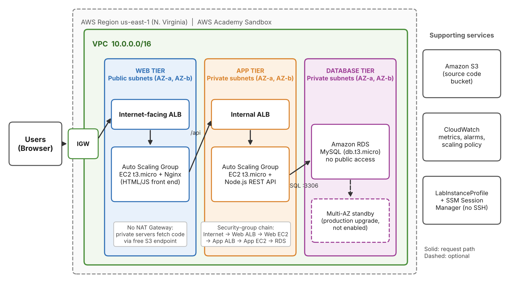

# Cloud Expense Tracker – Three-Tier Web Application on AWS

**UCS531 Cloud Computing project · Thapar Institute of Engineering and Technology**

A simple expense tracker (add, view and delete expenses) deployed on AWS using a scalable,
highly available **three-tier architecture**: web tier, application tier and database tier,
each in its own subnets across two Availability Zones.



## Architecture

| Tier | AWS services | What runs there |
|---|---|---|
| Web | Internet-facing ALB, EC2 Auto Scaling group (public subnets) | Nginx serving the HTML/JS front end, forwarding `/api` to the app tier |
| App | Internal ALB, EC2 Auto Scaling group (private subnets) | Node.js + Express REST API |
| Database | Amazon RDS for MySQL (private subnets, no public access) | `transactions` table |
| Supporting | VPC, security groups, S3, CloudWatch, IAM instance profile, Systems Manager | networking, code storage, monitoring, access |

**Request flow:** Browser → Internet Gateway → `web-alb` → Nginx (web EC2) → `app-alb` →
Node.js API (app EC2) → RDS MySQL.

**Security:** security groups are chained, so each tier accepts traffic only from the tier
in front of it (`web-alb-sg → web-sg → app-alb-sg → app-sg → db-sg`). The app servers and the
database have no public access. Instances are managed with Session Manager instead of SSH keys.

**Scalability and availability:** both EC2 tiers run in Auto Scaling groups (min 1, max 3)
across two AZs with ELB health checks. Failed instances are replaced automatically, and
target-tracking policies add instances when average CPU rises.

**Cost:** built in AWS Academy Learner Lab with t3.micro / db.t3.micro instances and no NAT
gateway. Servers are configured once in a public subnet and saved as AMIs, so the private
instances never need internet access.

## Syllabus topics demonstrated

Virtualization (EC2, AMIs) · scalability and elasticity (Auto Scaling) · load balancing (ALB) ·
cloud networking (VPC, subnets, routing) · Database-as-a-Service (RDS) · high availability
(multi-AZ design) · cloud security (IAM, security groups) · monitoring (CloudWatch).

## Repository structure

```
app-tier/          Node.js REST API (index.js, db.js, package.json, .env.example)
web-tier/          Front end (index.html, app.js, style.css) and nginx.conf
database/          schema.sql (the API also creates the table automatically)
scripts/           app-setup.sh, web-setup.sh (EC2 setup), loadtest.js (scaling demo)
docs/              BUILD_GUIDE.md (step-by-step AWS console guide), architecture.png
```

## API

| Method | Path (via web tier) | Description |
|---|---|---|
| GET | `/api/health` | App server health |
| GET | `/api/health/db` | Checks the RDS connection |
| GET | `/api/transaction` | List transactions |
| POST | `/api/transaction` | Add `{ description, amount, category }` |
| DELETE | `/api/transaction/:id` | Delete one transaction |
| DELETE | `/api/transaction` | Delete all transactions |
| GET | `/api/compute?ms=200` | Burns CPU, used only for the auto-scaling demo |

Every API response includes the name of the app server that handled it, so load balancing
is visible in the UI.

## Deploying

**Automated (AWS CLI):** from a folder containing `deploy.sh`, `app-tier/` and `web-tier/`, run
`bash deploy.sh all`. It builds the whole architecture in about 40 minutes and prints the website URL.
Other commands: `status`, `pause` (stop EC2 + RDS to save credit), `resume`, `teardown` (delete everything).

**Manual (AWS console):** follow **[docs/BUILD_GUIDE.md](docs/BUILD_GUIDE.md)**. Summary:

1. Create the VPC (2 public + 4 private subnets, no NAT gateway) and five security groups
2. Upload `app-tier/`, `web-tier/` and `scripts/` to an S3 bucket
3. Create RDS MySQL (`db.t3.micro`, private, initial database `expensedb`)
4. App tier: build instance → `app-setup.sh` → AMI → internal ALB → launch template → Auto Scaling group
5. Web tier: build instance → `web-setup.sh` → AMI → public ALB → launch template → Auto Scaling group
6. CloudWatch dashboard, then demo load balancing, self-healing and auto scaling

## Running the API locally (optional)

```bash
cd app-tier
npm install
export DB_HOST=localhost DB_USER=root DB_PASSWORD=yourpass DB_NAME=expensedb
node index.js            # http://localhost:4000/health
```

## Screenshots

_Add screenshots from your deployment here (working app, target groups, scaling activity, CloudWatch)._

## Team

| Name | Roll No. | Role |
|---|---|---|
| | | Networking, security groups, documentation |
| | | Database and app tier |
| | | Web tier, monitoring, demo |
